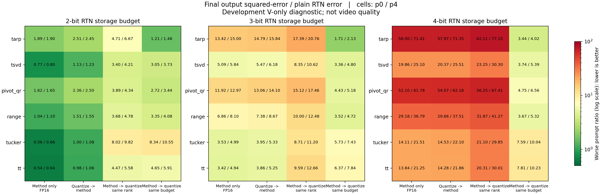

# 6개 방법 × 양자화 순서 × 2·3·4비트

2026-10-30. 개발 검사 450행 완료. 원본 입력 방법 6개, 4개 저장/순서 조건, 직접 RTN 기준선.

## 결과와 다음 단계

요청한 양자화 결합 경로에서는 두 프롬프트 모두를 만족하는 품질 개선 또는 절반 용량/오차 유지 후보가 없었다. 사용자 지시에 따라 결합 변형을 더 늘리지 않고 방법 2로 진행한다.

단, 분해만 하고 FP16 인자로 저장한 2비트 예산에서는 Tucker와 TT가 양쪽 프롬프트에서 직접 RTN과 t-SVD보다 오차가 작았다. 이 관찰은 버리지 않고 기존 분해 활용 후보로 보존한다. 양자화 결합의 성공이나 새로운 알고리즘 기여는 아니다.

## 범위와 표현

기존 개발 p0/p4 seed101, 층0/14/29, chunk6 V, 미래 chunk7 query32. BF16 K 고정. 두 창에서 새 V 오차의 post-Wo squared contribution D를 평균하고 3층 평균한다. 전체 출력/긴 생성 품질이 아니다. 미래 query는 fitting에 사용하지 않는다. 선택 시드9101 하나(이전 5시드 실험과 구별).

T-ARP는 공통 열 선택+최소제곱, t-SVD는 Fourier 저랭크, pivot_qr은 펼친 행렬의 피벗 QR, range는 Gaussian range+power1, Tucker는 HOSVD, TT는 공간→시간→채널 TT-SVD다. 모두 기존 방법이며 신규성 주장 없음.

방법→양자화는 실제 인자 2/3/4비트 패킹이다. 같은 rank에서는 공간이 크게 줄어들고, 같은 예산에서는 rank를 높인다. 인자 양자화는 연속 16원소 블록 RTN이며 원래 V의 토큰축 g16과 축이 다르다. Gauge/scale balancing 최적화 없음. 이번 T-ARP의 fit은 FP32 열 기준이므로 과거 FP16 열 기준 버전과 비트 일치 요구하지 않음.

## 직접 양자화 D=1인 최종 오차 비율

각 구간은 두 프롬프트의 값이며 신뢰구간이 아니다. 낮을수록 좋다. 높은 비트의 큰 비율은 직접 양자화 기준 오차가 작아지기 때문이며 영상 품질 배수가 아니다.

| 비트 | 방법 | 방법만(FP16) | 양자화→방법 | 방법→양자화 같은 rank | 방법→양자화 같은 예산 |
|---|---|---:|---:|---:|---:|
| 2 | tarp | 1.886–1.897 | 2.454–2.506 | 4.710–6.674 | 1.210–1.480 |
| 2 | tsvd | 0.773–0.804 | 1.131–1.235 | 3.404–4.206 | 3.050–3.725 |
| 2 | pivot_qr | 1.619–1.652 | 2.363–2.501 | 3.894–4.342 | 2.724–3.441 |
| 2 | range | 1.044–1.099 | 1.511–1.550 | 3.685–4.777 | 3.352–4.079 |
| 2 | tucker | 0.562–0.661 | 1.002–1.083 | 8.024–9.818 | 8.344–10.549 |
| 2 | tt | 0.544–0.645 | 0.984–1.061 | 4.469–5.578 | 4.651–5.913 |
| 3 | tarp | 13.420–14.997 | 14.791–15.840 | 17.389–20.765 | 1.707–2.127 |
| 3 | tsvd | 5.091–5.835 | 5.469–6.185 | 8.351–10.615 | 3.357–4.797 |
| 3 | pivot_qr | 11.919–12.969 | 13.058–14.104 | 15.122–17.460 | 4.430–5.177 |
| 3 | range | 6.858–8.100 | 7.383–8.666 | 10.005–12.484 | 3.525–4.725 |
| 3 | tucker | 3.526–4.995 | 3.951–5.334 | 8.711–11.205 | 5.726–7.431 |
| 3 | tt | 3.422–4.936 | 3.859–5.250 | 9.586–12.664 | 6.367–7.844 |
| 4 | tarp | 58.001–71.412 | 57.968–71.352 | 62.111–77.155 | 3.439–4.017 |
| 4 | tsvd | 19.860–25.101 | 20.371–25.511 | 23.247–30.296 | 3.736–5.391 |
| 4 | pivot_qr | 52.102–61.779 | 54.070–62.161 | 56.247–67.413 | 4.750–6.563 |
| 4 | range | 29.179–36.791 | 29.662–37.511 | 31.865–41.269 | 3.666–5.321 |
| 4 | tucker | 14.107–21.510 | 14.525–22.097 | 21.100–29.848 | 7.593–10.044 |
| 4 | tt | 13.835–21.254 | 14.281–21.858 | 20.312–30.010 | 7.811–10.231 |

셀은 p0/p4의 D 비율, 색은 두 값 중 큰 값이다. 녹색은 직접 RTN보다 작은 오차다.

## 실제 저장량과 rank

한 층 V tensor payload: 인자 코드/scale/index 포함. 원본·중간/전체 복원 버퍼·파일 header·allocator는 별도. 디스크 artifact 크기와 GPU 상주 payload를 혼동하지 않는다. 정수 rank/표현 상한 때문에 남는 예산은 쓰지 않았다.

| 비트 | 방법 | FP16 rank/bytes | 같은 rank 양자화 bytes | 같은 예산 양자화 rank/bytes |
|---|---|---:|---:|---:|
| 2 | tarp | 22 / 2,674,848 | 502,392 | 118 / 2,694,648 |
| 2 | tsvd | 22 / 2,673,792 | 501,336 | 118 / 2,688,984 |
| 2 | pivot_qr | 23 / 2,655,120 | 498,732 | 124 / 2,688,816 |
| 2 | range | 23 / 2,654,016 | 497,628 | 124 / 2,682,864 |
| 2 | tucker | 60 / 2,690,136 | 504,401 | 299 / 2,689,421 |
| 2 | tt | 60 / 2,689,920 | 504,360 | 299 / 2,689,380 |
| 3 | tarp | 29 / 3,525,936 | 882,528 | 118 / 3,590,976 |
| 3 | tsvd | 29 / 3,524,544 | 881,136 | 118 / 3,585,312 |
| 3 | pivot_qr | 31 / 3,578,640 | 895,776 | 124 / 3,583,104 |
| 3 | range | 31 / 3,577,152 | 894,288 | 124 / 3,577,152 |
| 3 | tucker | 77 / 3,546,528 | 886,635 | 299 / 3,585,895 |
| 3 | tt | 77 / 3,546,312 | 886,580 | 299 / 3,585,840 |
| 4 | tarp | 36 / 4,377,024 | 1,369,008 | 118 / 4,487,304 |
| 4 | tsvd | 36 / 4,375,296 | 1,367,280 | 118 / 4,481,640 |
| 4 | pivot_qr | 38 / 4,386,720 | 1,372,104 | 124 / 4,477,392 |
| 4 | range | 38 / 4,384,896 | 1,370,280 | 124 / 4,471,440 |
| 4 | tucker | 94 / 4,444,536 | 1,388,918 | 299 / 4,482,368 |
| 4 | tt | 94 / 4,444,320 | 1,388,850 | 299 / 4,482,300 |

RTN 기준 bytes: 2비트 2,697,216 / 3비트 3,595,776 / 4비트 4,494,336.

## 비용과 검증

summary.csv에 모든 조건의 encode/decode 시간을 기록했다. Encode는 선양자화/복원·분해·인자 저장 비용을 포함한다. 분해는 첫 실행 시간, 공유 계산해도 각 행에 비용을 청구했다. Decode는 warmup1+3회 median. 배포 속도 순위를 확정하는 벤치마크가 아니다.

전체 실행 68.70초; 진단 peak allocated 0.736 GiB, reserved 0.895 GiB. 모델 실행 없이 저장된 BF16 입력 사용.

Synthetic fullrank matrix/lowrank tensor/scalar bitpack/actual byte rank 검사4개 통과. 450행 finite·예산, 432상태 CPU/GPU 복원, source/input/payload SHA 검증. 직접 RTN 기준값은 이전 결과와 일치. 같은 작성자의 검증이며 독립 외부 감사 아님.

[계획·출처](../CODEC_ORDER_DEVELOPMENT.md) · [원시 행](rows.csv) · [프롬프트별 요약](summary.csv) · [진행 판단](decision.json).
