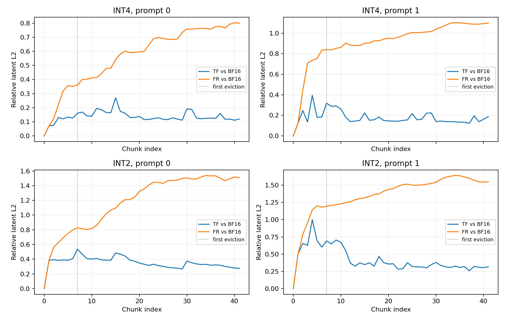
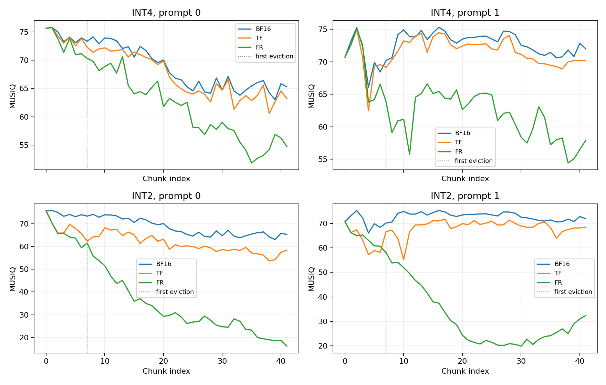

# P3 TF/FR pilot results

Fixed protocol: [P3_TF_FR_PILOT.md](../P3_TF_FR_PILOT.md).
Two new prompts, seed 0, 126 latent frames, RTN P3 group 16, no sink/bias.
Original BF16 gates passed before measurement; see evidence for the exact teacher-cache path.
A matching post-pilot anchor identity check, when present, is recorded separately.

| Bits | Prompt | Late TF rel | Late FR rel | Late TF−BF16 MUSIQ | Late FR−BF16 MUSIQ |
|---|---|---|---|---|---|
| 4 | 0 | 0.1288 | 0.7328 | -1.35 | -8.11 |
| 4 | 1 | 0.1592 | 1.0455 | -1.49 | -12.30 |
| 2 | 0 | 0.3116 | 1.4813 | -7.15 | -40.86 |
| 2 | 1 | 0.3196 | 1.5516 | -3.58 | -49.14 |

Late = chunks 21–41. All window summaries exclude chunk 0.
These are descriptive observations from n=2, not evidence of equivalence or generalization.
FR−TF distances are not an additive causal decomposition; chaotic divergence is included.
MUSIQ and the motion proxy do not establish subject/identity preservation.
Sampling peak includes concurrent reference/TF/FR caches and is not a per-policy memory comparison.

Per-window values: [windows.csv](windows.csv). Full compact evidence: [evidence.json](evidence.json).
Videos remain outside Git at `${DATA_ROOT}/p3_pilot`. Final latent tensors are retained or hash-verified after recovery; historical cleanup records remain separate.
