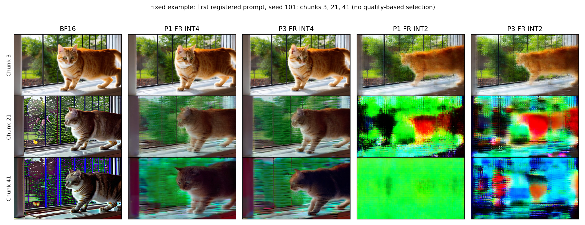

# P1 rolling / P3 chunk 저장 정책 실험 최종 보고

## 통합 결론

80개 생성 실험과 기존 영상 260개 추가 평가를 모두 마쳤다.
이 설정에서 P3는 P1보다 후반 프레임 MUSIQ와 DINO 프레임 특징 일관성이 높았다.
시간 품질 개선까지 확인한 결과는 아니다. INT4의 움직임 보정 잔차 차이는 탐색 구간에
0을 포함하고, INT2의 전체 표본 잔차 비교는 유효 대응 영역이 없는 한 건 때문에 미정의다.
INT2는 두 정책 모두 심각한 품질 손상을 보이므로 P3의 상대적 우위를 실용적 품질로 해석하면 안 된다.

[자체 리뷰와 미해결 검증 범위](../policy_supplement_results/SELF_REVIEW_KO.md): 시간 진단은
청크 경계 전환을 포함하지 않으며, DINO는 추적한 객체의 동일성 지표가 아니다.
집계 재검사는 외부 독립 검증 또는 공식 VBench와의 수치 대조를 의미하지 않는다.

## 완료 상태

2026-10-29 02:33 KST에 사전 등록한 80개 실험과 최종 분석을 완료했다.
프롬프트 10개 × 시드 2개 × INT4/INT2 × 저장 정책 2개를 모두 실행했다.
실험 결과는 `44c7e7c`로 커밋하고 GitHub에 반영했다.
실행 중 기록된 인프라 재시도와 잡음 대조군 수치 불안정은 모두 0건이다.
최종 TF/FR/잡음 텐서 240개와 공유 BF16 기준 텐서 20개를 로컬에 보관한다.

## 핵심 결과

같은 명목 비트폭에서 P3 chunk가 P1 rolling보다 후반 프레임 품질을 더 잘 유지했다.
주지표는 청크 21–41에서 각 청크의 가운데 원본 디코딩 프레임을 평가한 MUSIQ 평균이다.
프레임 품질도 청크 내부 표본이며 경계 프레임은 측정하지 않았다.
경계에서 손상이 가장 클 것이라는 주장은 아직 가설이다. eviction의 영향은 청크 전체로
퍼질 수 있고 VAE의 시간축 디코딩도 있어, 픽셀 경계 쌍 하나가 그 영향을 완전히 분리하지는 않는다.
두 시드를 프롬프트 안에서 평균하고, 독립 분석 단위를 프롬프트 10개로 잡았다.

| 설정 | BF16 | P1 rolling FR | P3 chunk FR | P3−P1 | 97.5% 신뢰구간 |
|---|---:|---:|---:|---:|---|
| INT4 | 71.44 | 55.94 | 63.63 | +7.69 | [+5.62, +9.92] |
| INT2 | 71.44 | 20.28 | 27.33 | +7.05 | [+3.33, +11.14] |

두 비트폭 모두 프롬프트별 시드 평균 차이가 10개 전부 양수였다.
사전 등록한 양측 부호 반전 검정의 Holm 보정 p값은 각각 0.00390625다.
이 검정은 귀무가설 아래 짝지은 차이의 교환 가능성/대칭성을 가정한다.
신뢰구간은 프롬프트 단위 부트스트랩이며, 표본 10개에서의 포함 확률은 근사적이다.

INT4에서도 P3는 BF16보다 약 7.81점 낮다. INT2는 P3도 BF16보다 약 44.11점 낮다.
따라서 P3의 상대적 우위와 실제 사용에 충분한 품질인지는 별도로 판단해야 한다.

## 보조 결과와 해석

TF의 후반 MUSIQ는 INT4에서 P1/P3 각각 70.35/70.71,
INT2에서 65.11/66.16이었다. FR에서는 더 크게 낮아졌다.
이는 생성 피드백을 포함한 실행에서 품질 저하가 커지는 패턴을 보이지만,
FR−TF를 원인별 오차의 가산 분해로 해석할 수는 없다.
TF 영상은 반사실적 청크를 이어 붙인 결과이고 VAE 디코딩 자체는 teacher forcing이 아니다.

양자화 FR의 각 저장 이벤트에서 측정한 절대 오차 노름을 고정해 재생한 무작위 방향
잡음 대조군의 MUSIQ는 INT4 P1/P3에서 71.71/71.53,
INT2 P1/P3에서 41.88/59.68이었다. 모두 해당 양자화 FR보다 높았다.
이 결과는 이 대조군에서 오차의 크기만으로 품질 저하를 설명하기 어렵다는 근거다.
누적 읽기 오차, 오차 좌표 또는 궤적을 일치시킨 대조군은 아니므로,
양자화 오차의 특정 구조나 카오스를 단일 원인으로 입증하지 않는다.

## 이번 실험으로 말할 수 있는 범위

- 이 모델·설정·10개 편의 표본 프롬프트에서 같은 명목 비트폭의 저장 정책 선택이
  후반 프레임 MUSIQ에 영향을 주며, P3가 P1보다 높은 결과를 보였다.
- 그룹 경계, 패딩, 현재 청크의 BF16 유지 여부, 재양자화 횟수가 함께 달라진다.
  차이를 재양자화 횟수 하나에 귀속할 수 없다.
- 같은 메모리 예산 비교가 아니다. 바이트 컨테이너와 BF16 attention을 사용하므로
  실제 저비트 커널의 메모리 절감이나 속도 향상을 주장하지 않는다.
- MUSIQ는 샘플링한 프레임의 품질 지표다. 시간적 일관성, 주체 유지, 프롬프트 충실도나
  새 알고리즘의 신규성은 입증하지 않았다.

## 후속 작업의 우선순위

1. DINO 특징 일관성과 움직임 보정 잔차의 기초 진단은 아래와 같이 완료했다.
   다음 시간 품질 검증에는 청크 경계 전환, 추적한 객체의 유지, 사람 평가 등을 포함할
   수 있다. 손상 영상에서 optical flow 자체가 부정확할 수 있어 개발용 검사가 먼저 필요하다.
2. 이번 추가 지표는 결과를 이미 본 뒤의 탐색 분석이다. 시간 품질이나 객체 유지에 대한
   새 확증 주장이 필요하면 별도의 보류 프롬프트와 사전 등록을 사용한다.
3. 정책 우위를 넘어 메모리 효율을 주장하려면 실제 저장 형식과 같은 메모리 예산의
   비교를 별도로 설계한다. 단일 메커니즘을 주장하려면 다른 정책 차이를 고정한 절제
   실험이 필요하다.

현재 본 실험과 아래 추가 평가는 종료 상태다. 새로운 대규모 생성 실험은 시작하지 않았다.
확보된 결과는 저장 정책 비교와 사후 진단의 근거로 사용하며, 시간 품질 개선이나
새 방법의 신규성을 주장하는 데 사용하지 않는다.

## 재현 및 근거

- [사전 등록 프로토콜](../P1_P3_MAIN_STUDY.md)
- [최종 영문 결과와 통계 가정](RESULTS.md)
- [프롬프트별 주지표 차이](paired_primary.csv)
- [전체 구간별 지표](windows.csv)
- [실행 비용과 메모리 진단](case_costs.csv)
- [원시 산출물 SHA256 목록](evidence.json)

원본 텐서·영상·호출별 기록은 `${HOME}/sfq_data/policy_study`에 보관한다.
완료된 실험을 다시 실행할 필요는 없다.

## 추가 평가 완료: 주체 특징과 시간 진단

기존 영상 260개 전체에 대한 사후 탐색 평가를 완료했다. 원본 생성 실험을 반복하지 않았다.
각 값은 프롬프트 안에서 시드를 평균한 뒤 프롬프트 10개를 짝지어 분석했다.

| 비트 | BF16 DINO | P1 FR DINO | P3 FR DINO |
|---|---:|---:|---:|
| INT4 | 0.8455 | 0.7318 | 0.7956 |
| INT2 | 0.8455 | 0.5253 | 0.5635 |

DINO 차이는 두 비트폭에서 모두 양수이고 아래 탐색적 구간도 0보다 높다.
이는 전체 프레임의 특징 유사도가 더 잘 유지된다는 보조 근거다. 추적한 객체의 동일성이나
프롬프트 충실도를 검증한 지표는 아니므로 주체 유지의 확증 결과로 부르지 않는다.
특히 INT2의 DINO 우위에는 동작 소실이 기여했을 가능성이 있다. P3의 추정 움직임이
BF16의 약 1/3이므로 높은 DINO 값을 주체 유지 개선으로 단정하지 않는다.
반대로 손상된 영상에서 flow 추정 자체가 틀릴 수 있어 동작 소실을 확정한 것도 아니다.
INT4 움직임 차이 구간이 0을 포함한다는 사실만으로 두 정책의 움직임이 동등하다고 볼 수 없다.

| 비트 | 지표 | 후반 P3−P1 FR 차이 | 탐색적 95% 구간 |
|---|---|---:|---|
| 4 | subject | +0.063798 | [+0.039265, +0.086481] |
| 4 | warp_error | +0.000538 | [-0.000033, +0.001054] |
| 4 | coverage | -0.006390 | [-0.013753, -0.000119] |
| 4 | flow_pixels | +0.071260 | [-0.061070, +0.253261] |
| 4 | raw_difference | +0.001186 | [+0.000202, +0.002039] |
| 2 | subject | +0.038290 | [+0.022506, +0.051445] |
| 2 | warp_error | 측정 불가 | 빈 대응 영역이 있는 영상 1개; 전체 표본 비교 미정의 |
| 2 | coverage | +0.010155 | [+0.003093, +0.018403] |
| 2 | flow_pixels | -0.353698 | [-0.810276, -0.091936] |
| 2 | raw_difference | -0.020605 | [-0.027722, -0.015026] |

subject는 높을수록 프레임 간 특징이 비슷하고, warp_error는 낮을수록 움직임 보정 후 잔차가 작다.
두 값 모두 주체 유지나 시간 품질의 완전한 척도는 아니다. 움직임(flow_pixels)과 유효 영역(coverage)을 함께 봐야 한다.
단순 프레임 차이(raw_difference)를 시간 품질 점수로 사용하지 않는다. 동작 소실이 점수를 높일 수 있다.
이 추가 평가는 압축 MP4에 기반하며, 사전 등록한 원본 프레임 MUSIQ와 측정 단계가 다르다.
지표 간 방향이 다르면 전체 영상 품질의 단일 우위로 요약하지 않는다. 확증적 발견이나 새 방법의 입증으로 해석하지 않는다.

INT4의 잔차 차이는 +0.000538이고 구간이 [-0.000033, +0.001054]다.
낮을수록 좋은 지표이므로 시간 품질 개선의 근거가 아니며, 구간에 0이 포함된다고 동등성을 뜻하지도 않는다.
INT2 P3의 추정 움직임은 0.196픽셀로 P1의 0.549, BF16의 0.648보다 작다.
동작 소실 또는 심한 영상 손상에서의 flow 추정 오류가 섞일 수 있어 일관성 점수만으로 품질을 판단하지 않는다.

총 21,840개 프레임 쌍 중 1개(`p04_s101_rolling_int2_fr`, 청크 41)에 유효 대응 영역이 없었다.
해당 영상을 제외하거나 임계값을 완화하지 않았다. 그 영상과 영향을 받는 전체 표본의
잔차 비교는 미정의로 남겼고, 다른 지표에는 모든 영상을 포함했다.
별도 감사 코드로 영상 260개의 SHA256, 10,920개 청크 기록, 21,840개 쌍 기록,
정확한 프롬프트/시드 집합, 결측을 포함한 집계와 부트스트랩 구간을 다시 계산했다.
작성자가 동일하므로 외부 독립 검증이 아니며 지표 자체의 타당성을 증명하지 않는다.
총 120개 탐색 대조에 다중 비교 보정을 하지 않았고, DINO의 구간을 확증 발견으로 해석하지 않는다.

아래 영상 예시는 결과를 보고 고른 사례가 아니라 첫 사전 등록 프롬프트와 시드 101을 사용했다.
청크 3, 21, 41의 같은 위치 프레임이다. 이 한 사례를 전체 표본의 대표적 우열로 일반화하지 않는다.
INT2의 심한 손상은 확인할 수 있지만 정지 이미지로 시간 품질을 판정할 수는 없다.

[집계 감사 기록](../policy_supplement_results/audit.json) · [정책별 후반 평균](../policy_supplement_results/late_arm_means.csv)

[추가 평가 상세 결과](../policy_supplement_results/REPORT_KO.md) · [고정한 평가 방식과 출처](../POLICY_STUDY_SUPPLEMENT.md)
