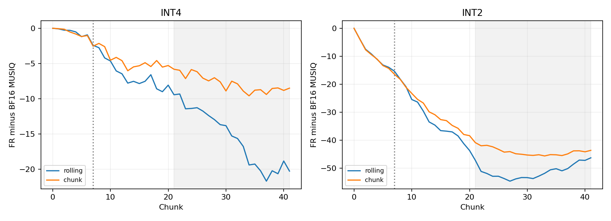
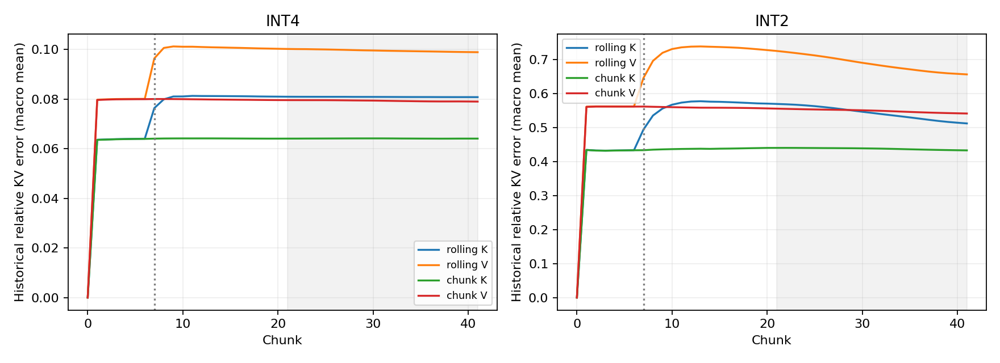

# P1/P3 registered study results

Protocol: [P1_P3_MAIN_STUDY.md](../P1_P3_MAIN_STUDY.md).
10 held-out original prompts × 2 seeds; 80 policy cases; 126 latent frames per trajectory.
All registered cases completed; development gates preceded held-out sampling.

## Primary prompt-paired frame-quality contrast

Positive = P3 FR has higher late MUSIQ than P1 FR. Seeds are averaged within prompt; n=10 prompts.
Intervals are 97.5% prompt-cluster percentile bootstrap; Holm adjusts the two sign-flip tests.

| Bits | P3−P1 MUSIQ | 97.5% CI | Exact p | Holm p |
|---|---:|---|---:|---:|
| 4 | +7.692 | [+5.617, +9.922] | 0.0020 | 0.0039 |
| 2 | +7.053 | [+3.330, +11.137] | 0.0020 | 0.0039 |

The sign-flip test assumes exchangeability/symmetry of paired differences under the null. Bootstrap coverage is approximate at n=10.

## Late arm scores (descriptive)

| Bits | Policy | BF16 | TF | FR | Noise FR |
|---|---|---:|---:|---:|---:|
| 4 | rolling | 71.44 | 70.35 | 55.94 | 71.71 |
| 4 | chunk | 71.44 | 70.71 | 63.63 | 71.53 |
| 2 | rolling | 71.44 | 65.11 | 20.28 | 41.88 |
| 2 | chunk | 71.44 | 66.16 | 27.33 | 59.68 |

## Storage-noise contrast (secondary)

| Bits | Policy | Quantized FR−noise FR MUSIQ | Exploratory 95% CI |
|---|---|---:|---|
| 4 | rolling | -15.773 | [-20.156, -11.910] |
| 4 | chunk | -7.898 | [-11.303, -5.183] |
| 2 | rolling | -21.597 | [-26.099, -17.601] |
| 2 | chunk | -32.342 | [-37.095, -28.064] |

The noise control replays fixed per-encode absolute innovation norms recorded from paired quantized FR; eligible support comes from the control input. It does not match accumulated read errors or establish a chaos baseline.
Numerically unstable noise controls: 0/80. Per the preregistered rule, no finite-only quality contrasts or imputed scores are reported. Primary TF/FR completeness remains mandatory.

## Scope and limitations

- Same nominal bit widths, not equal memory budgets; byte-container simulation with BF16 attention. No packed-kernel speed or memory claim.
- Policy changes include grouping, padding, current-chunk precision and re-quantization. This does not isolate one mechanism or establish a new method.
- MUSIQ measures sampled frame quality. No subject-consistency, semantic-faithfulness or temporal-quality claim; adjacent-frame difference is only a motion proxy.
- TF images stitch counterfactual chunks, and VAE decoding is not teacher-forced. FR/TF latent distances are descriptive, not an additive causal decomposition.
- Ten convenience prompts and two seeds provide limited coverage; chunks and seeds were not counted as independent samples.

Data: [all windows](windows.csv), [prompt-paired primary differences](paired_primary.csv), [evidence and artifact hashes](evidence.json).
Final latent tensors, videos and raw call metrics remain outside Git under `${HOME}/sfq_data/policy_study`.

Execution and whole-video motion diagnostics: [case_costs.csv](case_costs.csv). Resident and hypothetical packed state bytes exclude diagnostic originals, which are listed separately. Sampling peaks include model/reconstruction states and are not packed-inference savings.
