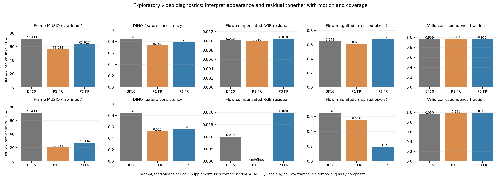

# 주체·시간 진단 추가 평가 (사후 탐색 분석)

기존 MP4 260개를 평가했다. 새 생성 실험 없이 전체 결과를 포함했다.
주지표 MUSIQ 사전 등록은 유지하며, 아래 구간은 결과를 본 뒤 추가한 탐색적 95% 프롬프트 부트스트랩 구간이다.

| 비트 | 지표 | P3−P1 FR 후반 차이 | 탐색적 95% 구간 |
|---|---|---:|---|
| 4 | subject | +0.063798 | [+0.039265, +0.086481] |
| 4 | warp_error | +0.000538 | [-0.000033, +0.001054] |
| 4 | coverage | -0.006390 | [-0.013753, -0.000119] |
| 4 | flow_pixels | +0.071260 | [-0.061070, +0.253261] |
| 4 | raw_difference | +0.001186 | [+0.000202, +0.002039] |
| 2 | subject | +0.038290 | [+0.022506, +0.051445] |
| 2 | warp_error | 측정 불가 | 빈 유효 영역이 있는 영상 1개; 전체 표본 비교 미정의 |
| 2 | coverage | +0.010155 | [+0.003093, +0.018403] |
| 2 | flow_pixels | -0.353698 | [-0.810276, -0.091936] |
| 2 | raw_difference | -0.020605 | [-0.027722, -0.015026] |

subject는 높을수록 프레임 간 특징이 비슷하다. 전체 프레임 특징이며 객체 추적 지표가 아니다.
warp_error는 낮을수록 움직임 보정 후 잔차가 작다. flow_pixels(움직임)와 coverage(유효 영역)를 함께 해석해야 한다.
정지·동작 소실·부정확한 optical flow도 점수에 영향을 준다. raw_difference는 단순 픽셀 차이이며 품질 점수가 아니다.
TF는 이어 붙인 반사실적 영상이므로 FR과 같은 의미의 시간 일관성으로 해석하지 않는다.
본 지표는 압축 MP4를 사용하므로 원본 프레임 MUSIQ와 입력 단계가 다르다.
전체 260개 중 빈 대응 영역을 포함한 영상 1개, 해당 프레임 쌍 1개를 모두 보존했다. 유효한 영상만 선택한 잔차 평균은 보고하지 않는다.

[프로토콜·출처](../POLICY_STUDY_SUPPLEMENT.md) · [전체 구간](windows.csv) · [집계와 무결성](summary.json)
공식 VBench 벤치마크 실행이나 새 방법의 입증을 의미하지 않는다.

## 해석과 통합 보고

P3의 DINO 특징 일관성은 INT4/INT2 모두 P1보다 높았다. 원래 주지표인 MUSIQ의
개선과 함께 볼 수 있는 보조 근거지만, 추적한 객체의 동일성이나 시간 품질의 확증은 아니다.
INT4 잔차 차이는 0을 포함하는 구간이며, INT2 잔차 비교는 미정의다.
INT2 P3의 추정 움직임도 낮아, 단순 일관성 점수를 품질 향상으로 해석할 수 없다.

시간 잔차는 각 청크 가운데 인접 쌍의 진단이며 청크 경계 전환 전체를 검사하지 않는다.
심하게 손상된 영상에서는 optical flow 추정 자체도 부정확할 수 있다.
정책 비교의 전체 결과와 한계는 [한글 통합 보고서](../policy_study_results/REPORT_KO.md)에 모았다.

[정책별 후반 평균](late_arm_means.csv) · [집계 감사](audit.json) · [고정 예시](fixed_example.png)

[자체 리뷰](SELF_REVIEW_KO.md): 집계 감사는 외부 검증이나 공식 VBench와의 수치 대조가 아니다.
신뢰구간도 별도 산술로 재계산했지만, 120개 탐색 대조의 다중 비교를 보정하지 않았으므로
새로운 확증 발견으로 해석하지 않는다. 평가 방식과 원래 수치는 유지했다.
