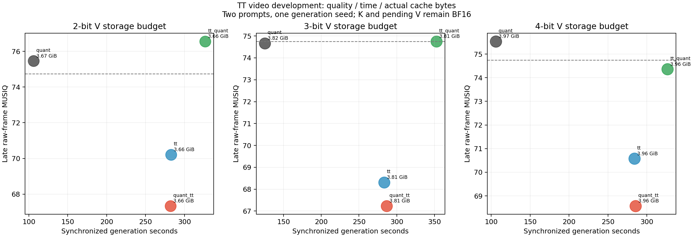

# TT 실제 영상: 네 경로 × 2·3·4비트 비교

2026-10-30. 개발 프롬프트 p0/p4, 생성 seed101, 각126 latent frames/42청크/501 pixel frames.

완료된 생성·품질 평가: **26/26 영상**. 모든 예정 사례를 포함했다.

## 비교 정의

- **TT만:** 원본 V→TT→FP16 인자 저장.
- **양자화만:** 원본 V→실제 packed RTN2/3/4.
- **양자화→TT:** RTN 복원값→TT→FP16 인자 저장.
- **TT→양자화:** 원본 V→TT→인자를 실제2/3/4비트 패킹.

30개 층의 **과거 V 캐시만** 압축했다. K와 현재 청크는 모든 팔에서 BF16이다. 직전 완료 청크를 한번 인코딩하는 같은 ChunkStore 정책을 사용한다. 전체 KV를2/3/4비트로 저장했다는 뜻이 아니다.

각 비트는 직접 V 양자화의 실제 저장 예산이다. TT만/양자화→TT의 rank는60/77/94, TT→양자화는 같은 예산에서 rank299를 사용한다. 이 표는 같은 rank 순서 효과와 구분한다. 인자 코드·scale은 실제 패킹했고 정수 rank로 남는 예산은 실제 바이트로 보고한다.

**양자화 기준의 정확한 의미:** 기존 고정 symmetric RTN은 qmax=2^(b−1)−1, 코드 범위[−qmax,qmax]를 쓴다. 따라서2비트는 실제2비트 패킹 안에 −1/0/1의 **3수준(ternary)**을 저장하며4수준 전체를 쓰지 않는다. 3/4비트도 각각7/15수준이다. TT의 비교 이득은 이 고정 기준선에 대한 결과이며 최적2비트 양자화기나 모든 저비트 방식에 대한 우위로 일반화하지 않는다. 결과를 본 뒤 양자화기를 바꾸지 않았다.

## 영상 품질·오차·속도·메모리 종합

아래는 두 프롬프트 개발 평균이다. 불완전 상태에서 한 프롬프트만 끝난 조건은 n=1로 표시한다. MUSIQ는 raw RGB8 전프레임, 후반은249..500이다. latent NMSE는 같은 BF16 생성과의 궤적 거리이지 시각적 품질 점수가 아니다. 캐시는 K+V+pending tensor payload이며 peak는 모델/작업 버퍼를 포함한다.

| 예산 | 경로 | n | MUSIQ 전체 / 후반 | 후반 latent NMSE | 생성 초 | 캐시 GiB | 생성 peak GiB |
|---|---|---:|---:|---:|---:|---:|---:|
| BF16 | BF16 기준 | 2 | 75.04 / 74.75 | 0.00000 | 68.27 | 5.624 | 8.642 |
| 2비트 | TT만 | 2 | 70.45 / 70.21 | 1.19193 | 282.81 | 3.664 | 6.920 |
| 2비트 | 양자화만 | 2 | 75.35 / 75.46 | 0.87584 | 106.18 | 3.666 | 6.959 |
| 2비트 | 양자화→TT | 2 | 69.40 / 67.33 | 1.29591 | 282.07 | 3.664 | 6.924 |
| 2비트 | TT→양자화 | 2 | 76.76 / 76.56 | 1.98999 | 326.70 | 3.664 | 6.951 |
| 3비트 | TT만 | 2 | 69.90 / 68.31 | 1.06623 | 283.37 | 3.808 | 7.047 |
| 3비트 | 양자화만 | 2 | 74.92 / 74.67 | 0.59417 | 125.08 | 3.816 | 7.103 |
| 3비트 | 양자화→TT | 2 | 69.25 / 67.23 | 0.98457 | 286.67 | 3.808 | 7.075 |
| 3비트 | TT→양자화 | 2 | 75.00 / 74.75 | 0.73464 | 352.57 | 3.815 | 7.103 |
| 4비트 | TT만 | 2 | 71.73 / 70.58 | 0.91808 | 283.87 | 3.959 | 7.198 |
| 4비트 | 양자화만 | 2 | 75.44 / 75.54 | 0.61294 | 106.10 | 3.967 | 7.219 |
| 4비트 | 양자화→TT | 2 | 70.69 / 68.57 | 0.94368 | 285.61 | 3.959 | 7.214 |
| 4비트 | TT→양자화 | 2 | 74.55 / 74.36 | 0.66892 | 326.53 | 3.965 | 7.232 |

## 같은 프롬프트의 직접 양자화 대비 차이

양수 MUSIQ 차이는 더 높은 점수, 시간 비율1 초과는 더 느림이다. 두 프롬프트를 따로 제시하며 n=2에 유의성이나 일반화 주장을 붙이지 않는다.

| 예산 | 경로 | 프롬프트 | 후반 MUSIQ 차이 | 경계 MUSIQ 차이 | 시간 배수 | 캐시 배수 |
|---|---|---|---:|---:|---:|---:|
| 2 | TT만 | p0 | -1.761 | -3.171 | 2.647 | 1.000 |
| 2 | TT만 | p4 | -8.739 | -7.500 | 2.680 | 1.000 |
| 2 | 양자화→TT | p0 | -6.747 | -5.139 | 2.648 | 1.000 |
| 2 | 양자화→TT | p4 | -9.511 | -7.302 | 2.665 | 1.000 |
| 2 | TT→양자화 | p0 | 2.409 | 2.458 | 3.071 | 1.000 |
| 2 | TT→양자화 | p4 | -0.219 | 0.404 | 3.083 | 1.000 |
| 3 | TT만 | p0 | -2.177 | -3.270 | 2.255 | 0.998 |
| 3 | TT만 | p4 | -10.528 | -7.077 | 2.275 | 0.998 |
| 3 | 양자화→TT | p0 | -2.684 | -3.715 | 2.286 | 0.998 |
| 3 | 양자화→TT | p4 | -12.188 | -7.853 | 2.297 | 0.998 |
| 3 | TT→양자화 | p0 | 0.261 | 0.033 | 2.814 | 1.000 |
| 3 | TT→양자화 | p4 | -0.089 | 0.207 | 2.824 | 1.000 |
| 4 | TT만 | p0 | -3.428 | -3.826 | 2.667 | 0.998 |
| 4 | TT만 | p4 | -6.491 | -4.081 | 2.684 | 0.998 |
| 4 | 양자화→TT | p0 | -1.695 | -2.712 | 2.683 | 0.998 |
| 4 | 양자화→TT | p4 | -12.234 | -7.408 | 2.700 | 0.998 |
| 4 | TT→양자화 | p0 | -0.445 | -0.434 | 3.072 | 0.999 |
| 4 | TT→양자화 | p4 | -1.909 | -1.395 | 3.083 | 0.999 |

## 개발 결과의 해석

- **2비트 예산의 TT만:** 두 개발 프롬프트 모두 후반 MUSIQ가 낮았다. 직접 양자화 대비 차이는 p0 -1.761점, p4 -8.739점, 생성 시간은 각각 2.647/2.680배였다. 이 비교는 개발 표본2개이며 보류 데이터의 확증 결과가 아니다.
  - 양자화→TT의 직접 양자화 대비 후반 MUSIQ 차이는 p0 -6.747점, p4 -9.511점이다. TT만의 효과를 이 결합 경로로 자동 확장하지 않는다.
  - TT→양자화의 직접 양자화 대비 후반 MUSIQ 차이는 p0 2.409점, p4 -0.219점이다. TT만의 효과를 이 결합 경로로 자동 확장하지 않는다.
- **3비트 예산의 TT만:** 두 개발 프롬프트 모두 후반 MUSIQ가 낮았다. 직접 양자화 대비 차이는 p0 -2.177점, p4 -10.528점, 생성 시간은 각각 2.255/2.275배였다. 이 비교는 개발 표본2개이며 보류 데이터의 확증 결과가 아니다.
  - 양자화→TT의 직접 양자화 대비 후반 MUSIQ 차이는 p0 -2.684점, p4 -12.188점이다. TT만의 효과를 이 결합 경로로 자동 확장하지 않는다.
  - TT→양자화의 직접 양자화 대비 후반 MUSIQ 차이는 p0 0.261점, p4 -0.089점이다. TT만의 효과를 이 결합 경로로 자동 확장하지 않는다.
- **4비트 예산의 TT만:** 두 개발 프롬프트 모두 후반 MUSIQ가 낮았다. 직접 양자화 대비 차이는 p0 -3.428점, p4 -6.491점, 생성 시간은 각각 2.667/2.684배였다. 이 비교는 개발 표본2개이며 보류 데이터의 확증 결과가 아니다.
  - 양자화→TT의 직접 양자화 대비 후반 MUSIQ 차이는 p0 -1.695점, p4 -12.234점이다. TT만의 효과를 이 결합 경로로 자동 확장하지 않는다.
  - TT→양자화의 직접 양자화 대비 후반 MUSIQ 차이는 p0 -0.445점, p4 -1.909점이다. TT만의 효과를 이 결합 경로로 자동 확장하지 않는다.

속도·오차·메모리·움직임을 종합해야 하므로 단일 지표로 최종 승자를 선언하지 않는다. TT 분해 자체가 좋은 경우와 저비트 인자 양자화까지 결합해 좋은 경우를 분리한다.

## 움직임·일관성·경계

DINO는 프레임 특징 일관성 proxy다. 움직임이 줄거나 화면이 정지하면 높아질 수 있으므로 flow magnitude를 함께 본다. RAFT warp residual도 움직임/가림/대응 영역에 영향을 받는다. 전체 subject identity 또는 시간 품질을 이 숫자만으로 확정하지 않는다. 빈 대응 영역이 있으면 warp를 미정의로 유지한다.

| 예산 | 경로 | 후반 DINO | 후반 내부 flow px | 후반 경계 flow px | 후반 내부 warp | 후반 경계 warp |
|---|---|---:|---:|---:|---:|---:|
| BF16 | BF16 기준 | 0.869 | 0.149 | 0.184 | 0.00816 | 0.01257 |
| 2 | TT만 | 0.678 | 0.628 | 0.438 | 0.00992 | 0.01489 |
| 2 | 양자화만 | 0.869 | 0.129 | 0.217 | 0.00827 | 0.01550 |
| 2 | 양자화→TT | 0.750 | 0.270 | 0.345 | 0.00904 | 0.01594 |
| 2 | TT→양자화 | 0.807 | 0.835 | 0.723 | 0.02208 | 0.03852 |
| 3 | TT만 | 0.721 | 0.664 | 0.476 | 0.00784 | 0.01228 |
| 3 | 양자화만 | 0.874 | 0.154 | 0.254 | 0.00837 | 0.01293 |
| 3 | 양자화→TT | 0.673 | 0.261 | 0.418 | 0.00663 | 0.01180 |
| 3 | TT→양자화 | 0.883 | 0.205 | 0.270 | 0.00812 | 0.01284 |
| 4 | TT만 | 0.795 | 0.260 | 0.268 | 0.00701 | 0.01145 |
| 4 | 양자화만 | 0.861 | 0.131 | 0.177 | 0.00775 | 0.01229 |
| 4 | 양자화→TT | 0.766 | 0.347 | 0.327 | 0.00737 | 0.01175 |
| 4 | TT→양자화 | 0.875 | 0.169 | 0.188 | 0.00850 | 0.01332 |

## 비용과 오차를 읽는 방법

- 표의 생성 시간(generation_seconds)은 CUDA 동기화한 실제 run_chunk wall time의 합이다. 모델 로딩·영상 디코딩·지표 평가·바깥 CPU latent 오차 계산/상태 IO는 제외한다. sampling_seconds는 그 바깥 계측까지 포함한 경과 시간으로 CSV에 별도 보존한다. ChunkStore 내부 저장 오차 계산은 생성 경로에 포함된다. 단일 실행의 개발 타이밍이며 반복/순서 교차 없는 결과를 최적화 kernel 성능으로 일반화하지 않는다.
- encode/restore CUDA event 합은 저장/복원 비용을 보여준다. ChunkStore의 저장 오차 기록용 복원도 포함되므로 순수 필수 attention 비용만이라고 부르지 않는다. 전체 wall과 합계가 정확히 같아야 하는 지표가 아니다.
- 실제 cache bytes는 K/V/pending을 나눈다. PyTorch peak allocated/reserved에는 모델·FP32 TT분해·전체 복원 작업 버퍼가 들어간다. cache 압축률과 peak 감소율은 다르다. 품질평가 peak는 별도 열이다.
- history V relative L2는 각 FR 실행의 삽입 당시 BF16 V 기준이다. BF16 기준 생성의 동일 V와 비교한 값이 아니다. latent 오차와도 다른 지표다.
- pixel MSE/PSNR은 같은 난수의 BF16 영상과 비교한 보조 거리다. 궤적이 달라져도 보기 좋은 영상일 수 있으므로 MUSIQ·움직임·육안 영상과 함께 판단한다.

## 산출물과 검증

[영상별 전체 수치](summary.csv) · [프롬프트별 직접 양자화 대비 차이](contrasts.csv) · [검증 기록](audit.json) · [사전 개발 계획](../TT_VIDEO_DEVELOPMENT.md).

잠재텐서와 프리뷰는 로컬 `~/sfq_data/tt_video/p{prompt}_b{bits}_{arm}/`의 `latent.pt`, `preview.mp4`에 보존한다. 지표는 MP4에서 측정하지 않았다. 원시 프레임별 MUSIQ·오차 및 RAFT 쌍은 각 `quality.json`, 청크별 시간/오차/캐시는 `sampling.json`에 있다.

보고서 검증은 저장 latent의 CPU FP64 오차 재계산, 프레임/쌍 선택과 요약 재계산, source/input/artifact SHA 확인이다. 동일 작성자의 재검산이며 외부 독립 재현이나 모델 재실행을 의미하지 않는다.

