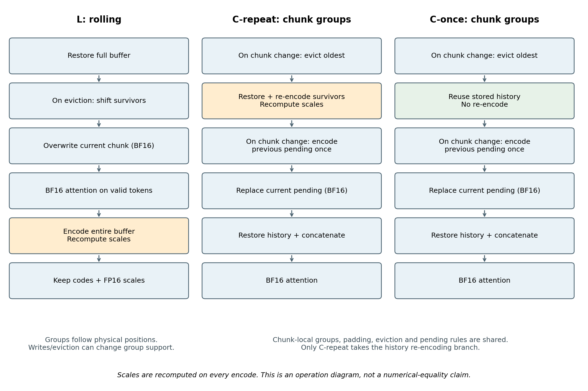
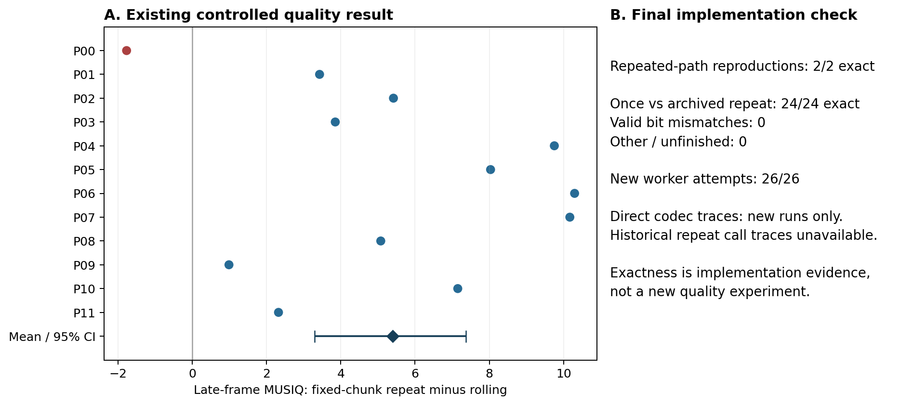

# 스트리밍 영상 KV 캐시의 품질 손상에서 반복 양자화와 그룹 규칙의 역할 구분

**현재 한국어 원고 · 2026-10-31.** 완료된 실험을 정리한 분석 연구다. 마지막 검증에서 자동 생성한 [결과 초안](../../src/experiments/repeat_once_final/PAPER_DRAFT_KO.md)과 9월 초안은 작성 당시의 기록으로 보존한다. 이 파일을 현재 원고로 사용한다.

## 초록

저비트 KV 캐시의 품질 손상을 반복 양자화의 누적으로 해석하려면, 반복 과정에서 양자화 그룹의 구성과 경계 처리가 달라지는지를 함께 확인해야 한다. 본 연구는 Wan2.1 기반 Self-Forcing의 스트리밍 영상 생성에서 물리 버퍼 기준 rolling 저장과 청크별 그룹을 유지하는 반복 저장을 비교한다. 12개 프롬프트와 각각 두 시드의 사전 지정 비교에서 청크별 반복 저장은 rolling보다 후반 전체 원본 프레임 MUSIQ가 평균 5.3935점 높았다. 프롬프트 단위 95% 부트스트랩 구간은 [3.2891, 7.3764]였고, 12개 중 11개 프롬프트에서 개선됐다. 반복을 유지한 개입에서도 품질이 개선됐으므로 관측된 정책 차이는 반복 횟수만으로 설명되지 않는다. 후속 구현 검증에서는 실제 재인코딩을 계측한 반복 경로 두 실행이 기존 출력과 일치했고, 청크별 단회 실행 24개도 대응하는 기존 반복 실행의 최종 잠재 텐서와 원소 바이트가 모두 같았다. 이 결과는 시험한 구현과 입력에서 반복 연산의 존재와 추가 최종 손상을 구분하는 근거다. 최종 잠재 텐서 일치는 모든 중간 캐시 값이나 모든 입력의 멱등성을 증명하지 않으며, 그룹 규칙 개입은 쓰기 경계와 퇴거에 따른 재편의 효과를 각각 분리하지 않는다. 본 연구의 결과는 저장 정책의 비교·보고·검증 절차에 관한 제한적 실증 근거다.

## 1. 서론

자기회귀 영상 생성은 이전 출력의 KV 캐시를 다음 청크의 문맥으로 사용한다. Self-Forcing은 자기 생성 문맥을 사용하는 학습과 rolling KV 캐시를 통해 이 실행을 지원한다. 압축된 캐시의 손상은 한 번의 attention뿐 아니라 이후 생성이 사용하는 문맥에도 연결될 수 있다. 따라서 KV 압축의 평가는 저장 오차, 현재 출력, 장기 생성 결과를 구분해야 한다. [Self-Forcing](https://arxiv.org/abs/2506.08009v2)

본 연구의 출발점은 같은 명목 비트폭에서 저장 정책에 따라 품질이 달라진다는 관찰이었다. 초기의 새 10프롬프트×2시드 비교에서 청크별 단회 저장은 rolling보다 후반 표본 프레임 MUSIQ가 INT4에서 7.69점, INT2에서 7.05점 높았다. 그러나 이 비교에는 반복 횟수뿐 아니라 그룹 구성, 패딩, 현재 청크의 저장 수명 차이가 포함된다. 이 차이를 곧바로 반복 횟수의 효과로 해석할 수 없다.

이 논문은 다음 질문에 답한다. **반복 양자화를 유지해도 청크별 그룹 규칙을 적용하면 품질이 개선되는가? 그리고 그 반복 경로와 단회 경로의 최종 출력은 실제 저정밀 구현에서 같아지는가?** 첫 질문은 별도의 프롬프트 집합에서 수행한 품질 비교로, 두 번째 질문은 이미 사용한 입력의 사후 구현 검증으로 다룬다.

기여는 세 가지다. 첫째, 반복을 유지한 그룹 규칙 개입과 후반 프레임 품질을 연결하는 대응 비교를 제공한다. 둘째, 실제 복원값의 재인코딩이 수행됐다는 직접 계측과 최종 텐서의 바이트 비교를 통해 연산의 존재와 출력 변화의 존재를 구분한다. 셋째, 이 결과를 이용해 저장 정책 비교에서 반드시 보고할 조건을 구체화한다. 청크별 단회 압축, 이상적 RTN의 멱등성 또는 재압축 드리프트의 최초 발견을 주장하지 않는다.

## 2. 관련 연구와 본 연구의 위치

KIVI는 K와 V의 분포를 구분해 각각 per-channel과 per-token 양자화를 제안한다. 이는 그룹 축 자체가 방법의 일부임을 보여준다. 본문의 주 실험은 대칭 RTN이며, 저장소의 legacy KIVI-style 경로는 공식 KIVI 전체 구현과 같지 않다. 본문의 결과로 KIVI의 성능 순위를 판단하지 않는다. [KIVI](https://arxiv.org/abs/2402.02750v2)

QVG는 유사 토큰의 centroid와 다단계 잔차 압축을 사용하는 영상 KV 양자화 방법이다. 원문 §5.1은 청크별 단회 압축으로 재압축 드리프트를 피한다고 명시한다. 따라서 단회 저장을 사용하는 것 자체는 본 연구의 신규 기여가 아니다. 본 연구는 시험한 RTN 구현에서 반복 횟수와 그룹 규칙을 구분해 비교하고 이를 전체 생성 결과와 연결한다. QVG 코드 전체에 특정 절제가 없다는 주장이나, 이 현상이 모든 기존 평가를 왜곡한다는 주장은 하지 않는다. [QVG, v5](https://arxiv.org/html/2602.02958v5)

Self-Forcing의 33방법 실증 연구는 다양한 양자화·저장 정책과 실제 peak 메모리 및 실행시간을 함께 평가한다. 부록은 매 단계 양자화와 refresh-only 등의 실행 조건을 구분한다. refresh-only는 clean-context refresh 때 쓰는 빈도 규칙이며, 저장 청크의 전체 수명에서 한 번만 인코딩하는 규칙과 자동으로 같아지지 않는다. 본 연구도 정책 이름만으로 경로를 분류하지 않고 실제 호출과 저장 수명을 확인한다. 해당 선행연구의 발표 수치가 우리의 경계 문제에 영향을 받았다고 단정하지 않는다. [33방법 연구, v1](https://arxiv.org/html/2603.27469v1)

최근 영상 KV 연구는 attention 민감도와 예측 압축으로 확장되고 있다. QuantWM은 query 민감도를 사용하는 clustering과 부분공간 attention 보정을, TempoKV는 시간 이력과 K→V 의존성을 사용하는 예측을, CORAL-KV는 층간 예측과 잔차 압축을 다룬다. 이들 방법에 대한 본 연구의 성능 우위는 측정하지 않았다. 이 문헌들은 단순한 복원 오차 개선이나 잔차 압축이라는 설명만으로 새 방법의 차별성을 주장하기 어렵다는 배경이다. [QuantWM, v3](https://arxiv.org/abs/2609.26425v3), [TempoKV, v1](https://arxiv.org/abs/2610.15324v1), [CORAL-KV, v1](https://arxiv.org/abs/2610.12514v1)

## 3. 저장 경로와 실제 양자화 연산

### 3.1 공통 설정과 표기

한 층의 K 또는 V 텐서는 `[B,L,H,D]`이며 토큰 축의 그룹 크기 `g=16`을 사용한다. 청크는 3잠재프레임, 프레임당 1,560토큰으로 총 `C=4,680`토큰이다. 캐시 용량은 `7C=32,760`토큰이며 현재 청크와 최대 여섯 개의 과거 청크가 attention에 참여한다. 첫 청크 고정 보존과 별도 residual window는 사용하지 않는다. 각 청크는 denoising 네 번과 clean-context refresh 한 번, 총 다섯 번의 호출을 거친다.

`E_G(x)`는 그룹 규칙 G에 따른 코드·scale 저장, `D`는 BF16 복원이다. 그룹 규칙에는 그룹의 시작점, 구성원, 마지막 부분 그룹의 패딩과 scale 산출 범위가 포함된다. 다음 표의 현재 청크는 attention에서 사용하는 값과 호출 사이 저장되는 값을 구분한다.

| 조건 | rolling / L | 청크별 반복 / C-repeat | 청크별 단회 / C-once |
|---|---|---|---|
| 그룹 기준 | 물리 버퍼 위치 | 각 청크 내부 위치 | 각 청크 내부 위치 |
| 과거 재인코딩 | attention 뒤 버퍼 전체 | attention 전 생존 과거 청크별 | 없음 |
| 기존 코드·scale 처리 | 복원 후 다시 계산 | 복원 후 다시 계산 | 저장 상태 유지 |
| 현재 청크 attention 입력 | 새 BF16 쓰기로 덮어씀 | 새 BF16 현재 청크 | 새 BF16 현재 청크 |
| 호출 사이 현재 청크 | 전체 양자화 상태에 포함 | BF16 pending | BF16 pending |
| 다음 청크 진입 | 물리 버퍼 이동·덮어쓰기 | 퇴거 후 이전 pending 최초 인코딩 | 같은 규칙 |
| attention 연산 | BF16 | BF16 | BF16 |



**그림 1.** 비교하는 실제 연산 순서. 청크별 두 경로는 같은 어댑터에서 반복 옵션만 다르다. C-repeat의 재인코딩은 새로 과거가 된 pending의 최초 인코딩보다 먼저 수행하므로 그 청크를 같은 첫 읽기에서 두 번 인코딩하지 않는다. L과 C-repeat의 전체 커널 호출 수는 처리 단위가 달라 직접 비교할 수 없다. 이 도식은 연산 정의이며 모든 중간 텐서의 수치 일치를 표시하지 않는다.

### 3.2 scale을 고정하는 구현이 아니다

실제 RTN은 각 입력 그룹에서 `max(abs(x))`를 다시 계산한다. INT4에서 양의 최대 코드는 7이며, 코드 계산은 입력 dtype에서 수행한다. 계산한 scale을 FP16으로 저장하고 복원 시 BF16으로 변환해 코드와 곱한다.

```text
Encode(x, g=16, b=4):
    토큰 축 길이를 g의 배수로 zero-pad
    그룹별·head별·channel별 M ← max(abs(x))
    s ← max(M / 7, 1e-8)                    # 입력 BF16 연산
    c ← clamp(round(x / s), -8, 7)          # 입력 BF16 연산
    return int8(c), FP16(s), 원래 형상

Decode(c, stored_s):
    y ← BF16(c) * BF16(stored_s)
    return 원래 유효 토큰 길이로 잘라낸 y
```

코드는 int8 컨테이너에 저장하며 본 실험의 INT4라는 명목은 실제 4비트 패킹을 뜻하지 않는다. C-repeat에서 다음 scale은 `s_new = s(Decode(c_old, s_old))`로 **재계산**한다. 이전 scale을 재사용하거나 복사를 생략하는 경로가 아니다. 실제 코드의 근거는 [양자화기](../../src/kvq/quant.py)와 [저장 어댑터](../../tools/mechanism_core.py)다.

### 3.3 한 attention 호출의 상태 전이

```text
L(query, current, start):
    buffer ← Decode(이전 전체 저장 상태), 또는 첫 호출이면 0 버퍼
    새 청크이고 용량을 넘으면 생존 영역을 물리 버퍼 앞쪽으로 이동
    buffer의 현재 위치 ← current
    output ← Attention(query, 유효 buffer)
    전체 저장 상태 ← Encode(buffer)          # 비어 있는 용량도 포함
    return output

C(query, current, start, repeat):
    새 청크이면 이전 pending을 넣을 공간을 확보하도록 오래된 segment 퇴거
    repeat이면 기존 생존 segment 각각에 대해:
        restored ← Decode(segment.state)
        segment.state ← Encode(restored)    # 실제 scale 재계산
    새 청크이고 이전 pending이 있으면:
        segments에 Encode(previous_pending)를 추가
    pending ← current의 BF16 복사
    history ← 각 segment의 Decode 결과를 순서대로 연결
    return Attention(query, history와 current)
```

L과 C-repeat는 모두 반복 양자화하지만 양자화 단위·경계·저장 수명이 다르다. 따라서 주 대비는 **청크별 그룹 규칙을 포함한 저장 정책 개입**으로 해석한다. C-repeat와 C-once 사이에서는 청크 보존·퇴거·pending·읽기 순서가 공통이고 반복 분기만 달라진다.

### 3.4 반복과 그룹 재편에 대한 수학적 해석

정확한 실수 연산과 고정 그룹에서 `q=2^(b−1)−1`, `s(x)=max(max_i|x_i|/q, ε)`, `Q(x)=s(x)round(x/s(x))`라 하자. 최대값이 scale을 정하면 양자화 후 최대 절댓값은 `q s(x)`이고 재계산한 scale도 같다. 최소 scale ε가 활성화된 경우도 재계산한 scale은 ε다. 따라서 이 이상적인 연산은 `Q(Q(x))=Q(x)`를 만족한다. 이 설명에서도 scale은 다시 계산하며, 같은 값이 나오는 것이 정리의 결과다.

실제 BF16 연산·FP16 저장의 반올림과 표현 범위는 위 실수 정리의 가정 밖이다. 이 때문에 구현 검증을 별도로 수행했다. 또한 `4,680 mod 16=8`이므로 쓰기 경계가 그룹 중간에 놓이고, 퇴거에 따른 재색인은 생존 토큰의 그룹 구성원을 바꿀 수 있다. 쓰기 경계의 scale 변화와 퇴거에 따른 재편은 서로 다른 경로이며 본 실험은 그 기여를 각각 추정하지 않는다.

재인코딩의 추가 변화를 δ라고 하면 원본 대비 오차는 `e_new=e_old+δ`다. 제곱 노름에는 교차항 `2⟨e_old,δ⟩`이 있으므로 δ가 0이 아니어도 원본 대비 오차가 항상 증가하지는 않는다. 저장소에는 증가 예와 감소 반례가 모두 있다. “그룹 재편은 모든 입력에서 해롭다”는 명제는 사용하지 않는다. [증명·반례·형식 증명의 범위](../../src/experiments/mechanism_diagnostic_results/THEORY_KO.md)

## 4. 실험 설계와 분석 단위

### 4.1 실험 집합을 분리한다

| 집합 | 입력·실행 | 목적·평가 | 본문에서의 역할 |
|---|---|---|---|
| 초기 정책 비교 | 새 10프롬프트×2시드, INT4/INT2; 공유 BF16 포함 260궤적 | 후반 청크마다 가운데 원본 프레임 MUSIQ | 문제 제기 |
| 개발 재생 진단 | 기존 2프롬프트×2시드, g=16/24/32 | BF16 쓰기 이력을 재생한 저장 오차 | 개입 설계와 정렬 조건 점검 |
| 주 품질 비교 | 별도 12프롬프트×2시드×BF16/L/C-repeat, 72궤적 | 후반 전체 원본 프레임 MUSIQ | 중심 결과 |
| 마지막 구현 검사 | 같은 12프롬프트×2시드의 단회24개와 지정 반복 재현2개 | 최종 잠재 텐서 바이트·실제 연산 호출 | 사후 해석 보강 |

마지막 검사의 24쌍을 새 품질 표본이나 새로운 독립 보류 표본으로 계산하지 않는다. 초기 비교의 +7.69점과 주 비교의 +5.39점은 표본과 평가 프레임 선택이 다르므로 차감해 원인별 기여율을 만들지 않는다.

### 4.2 모델과 재현 조건

모델은 Wan2.1-T2V-1.3B 기반 Self-Forcing이며 단일 RTX 4090 24GB에서 실행했다. Self-Forcing 추론 소스의 기준 revision은 `33593df3e81fa3ec10239271dd2c100facac6de1`이다. 생성은 42청크·126잠재프레임이며 디코딩하면 501프레임이다. 청크별 독립 난수 스트림을 사용하고, 양자화 없는 저장 경로와 기존 BF16 결과의 일치 검사를 선행했다. 모델·소스·프롬프트·산출물 해시는 각 등록 및 manifest에 보존한다. [출처](../../src/vendor/UPSTREAM.md), [재구현 검증](../../src/docs/VERIFY.md)

주 품질 비교는 개발 진단의 고정 진행 조건과 실행 게이트를 통과한 뒤 계획을 봉인했다. 프롬프트별 두 시드 303/404를 평균하고, 독립 분석 단위를 프롬프트 12개로 삼았다. 한 영상의 수백 프레임을 독립 표본으로 세지 않는다. 프롬프트 목록은 공개된 [입력 파일](../../src/experiments/mechanism_prompts_v0.txt)에 고정돼 있다.

### 4.3 품질 지표와 통계

주지표는 MP4 압축 전 원본 디코딩 영상의 0부터 시작하는 프레임 인덱스 249–500, 총 252프레임의 MUSIQ 평균이다. MUSIQ는 이미지 품질 지표이며 이를 영상의 움직임·객체 동일성·프롬프트 충실도 전체의 점수로 해석하지 않는다. [MUSIQ](https://arxiv.org/abs/2108.05997)

프롬프트별 대응 차이를 `d_i`라 하면 주 효과는 `mean(d_i)`다. 양측 정확 부호 반전 검정은 12개 차이의 4,096가지 부호 조합을 전부 열거한다. 귀무가설 아래 차이의 대칭성/부호 교환 가능성이 필요하다. 95% 구간은 프롬프트 단위 percentile bootstrap 20,000회, 고정 시드 872341로 산출했다. 작은 편의 표본에서 구간의 포함 확률은 근사적이다. 주 검정은 하나이며 경계·DINO·시간 잔차 결과는 보조 기술 통계다. [등록](../../src/experiments/mechanism_fr_registration.json), [분석 코드](../../tools/analyze_mechanism_fr.py)

## 5. 결과

### 5.1 반복을 유지한 그룹 규칙 개입의 품질 효과

| 경로 | 후반 전체 원본 프레임 MUSIQ |
|---|---:|
| BF16 | 70.7272 |
| L / rolling | 56.4788 |
| C-repeat / 청크별 반복 | 61.8723 |

주 대비 C-repeat−L은 **+5.393499점**, 95% 구간 **[+3.289134, +7.376351]**, 정확 양측 p값 **0.00146484375**다. 12개 프롬프트 중 11개에서 양수이고 하나는 −1.7687점이다. 평균 개선을 모든 프롬프트의 개선으로 바꾸지 않는다. C-repeat도 BF16보다 평균 약 8.85점 낮으므로 BF16 품질을 회복했다는 결과가 아니다.



**그림 2.** 왼쪽은 프롬프트 안에서 두 시드를 평균한 주 품질 차이이며, 마지막 기호는 평균과 프롬프트 부트스트랩 구간이다. 오른쪽은 별도 사후 구현 검증의 결과다. 주 품질 결과와 구현 검사의 표본을 합쳐 유의성을 계산하지 않았다. [전체 품질표](../../src/experiments/mechanism_fr_results/windows.csv), [집계 근거](../../src/experiments/mechanism_fr_results/evidence.json)

경계 표본의 C-repeat−L 차이는 약 +5.26점, 내부 표본은 약 +5.38점이다. 경계에서만 특별히 개선됐다는 근거는 없다. 이 보조 비교도 프레임 품질이며 시간 불연속의 순수 인과 효과가 아니다. [보조 결과](../../src/experiments/mechanism_fr_results/auxiliary.json)

### 5.2 마지막 구현 검사: 연산은 달랐고 최종 텐서는 같았다

지정한 반복 재현은 p00/303과 p11/404 두 개다. 두 실행 모두 과거 대응 결과와 형상·dtype·원소 바이트가 일치하고 실행 게이트를 통과한 뒤 단회24개를 진행했다. 단회24개 모두 기존 반복 결과와 최종 잠재 텐서의 원소 바이트가 같았다. 유효 불일치·무효·미완료·재시도는 없었다.

| 층별 실제 호출 | 반복 재현 2개, 각 30층 | 단회 24개, 각 30층 |
|---|---:|---:|
| 최초 K 인코딩 / V 인코딩 | 각각 41 | 각각 41 |
| 복원값 K 재인코딩 / V 재인코딩 | 각각 1,114 | 각각 0 |
| K·V 쌍 인코딩 합계 | 1,155 | 41 |
| attention 호출 | 210 | 210 |

마지막 현재 청크는 pending으로 남으므로 최초 인코딩은 42회가 아니라 41회다. 기대되는 층별 반복 쌍 수는 `5 Σ(c=0..41) min(c,6)=1,155`이며, 이 식을 출력하는 것으로 계측을 대신하지 않았다. 실제 `Quantizer.encode` 진입·반환에서 K/V와 최초/재인코딩을 기록하고 층별로 대조했다. 이전 상태의 실제 `restore` 반환 텐서가 재인코딩 입력 객체로 전달되는지도 확인했다. 계측용 복원·양자화 호출은 추가하지 않았으며 CPU 합성 입력에서 계측 ON/OFF의 출력과 실제 codec 호출 수가 같았다.

입력 객체의 전달 경로 검사는 모든 과거 입력 원소를 별도로 복사해 대조한 검사가 아니다. 반면 **최종 잠재 텐서**는 형상·dtype 확인 후 CPU contiguous uint8 바이트를 직접 비교했다. 파일 SHA256은 저장 산출물의 무결성 검사용으로 분리했다. 수치 동등성만 확인하는 검사와 달리 부호가 다른 0도 바이트 차이로 검출한다.

직접 계측한 범위는 새 반복2개와 단회24개다. 과거 반복24개에는 해당 호출 로그가 없으므로 사후 계측했다고 주장하지 않는다. 또한 최종 잠재 텐서 일치로 모든 중간 캐시 값이 같다고 결론 내리지 않는다. 원본 텐서·이벤트 로그·결과 파일 78개의 해시와 저장된 실제 이벤트의 층별 횟수도 별도 코드로 재집계했다. 이는 같은 연구 작업 주체의 재검사이며 외부 독립 검증은 아니다. [최종 보고](../../src/experiments/repeat_once_final/REPORT_KO.md), [재집계](../../src/experiments/repeat_once_final/final_audit.json)

### 5.3 실행 비용의 범위

마지막 구현 검사는 2026-10-31 01:03:06 KST에 시작해 02:00:26에 집계를 마쳤다. 경과는 3,439.61초, 약 57분 20초이며 26회 상한 안에서 26회 모두 유효 완료했다. 기존 TT 작업과 GPU 유휴 대기는 이 예산의 시작 전이다. 이 계측 실행의 시간은 추론 성능 벤치마크로 보고하지 않는다.

별도의 기존 개발 입력·3회 반복 벤치에서 생성 시간 중앙값은 BF16 68.25초, L16 90.49초, C-repeat16 82.06초, C-once16 72.19초였다. 모델 로딩·VAE·저장·품질 평가는 제외한 생성 시간이다. C-once의 반복 제거가 이 구현의 비용을 줄이는 관찰은 있지만, 인코딩 호출 감소율을 전체 속도 향상률로 바꾸지 않는다. L16과 청크 경로의 실제 상주 캐시는 각각 약 3.164/3.519GiB로 청크 경로가 더 컸다. 따라서 같은 명목 비트폭에서의 품질 차이와 같은 메모리 예산의 효율 우위는 구분한다. [벤치 원자료](../../src/experiments/mechanism_diagnostic_results/performance.json)

## 6. 연구자와 구현자가 바꿔야 할 비교·보고 절차

첫째, 정책 간 품질 차이를 반복 압축 때문이라고 해석하기 전에 그룹 구성원, scale 산출 범위, 쓰기와 퇴거 시 그룹 경계가 유지되는지 확인한다. 고정 그룹 반복과 그룹 재편 반복은 같은 실험 조건이 아니다.

둘째, 정책 이름과 비트폭만 보고하지 않는다. 반복 시점·횟수, 그룹의 기준 좌표, 패딩, 현재 청크의 읽기 정밀도와 호출 사이 저장 형식, 퇴거 순서, 복원 시점, attention dtype을 함께 기록한다. 메모리는 명목 payload, 실제 컨테이너·scale·pending, 복원 작업공간과 전체 peak를 구분한다.

셋째, 반복 제거를 최적화로 적용할 때에는 이상적 멱등성만으로 실제 저정밀 경로를 생략하지 않는다. 해당 구현의 출력 동등성과 실제 호출 차이를 검증한다. 출력이 같다는 사실만으로 반복 분기가 실제로 실행됐다고 추정하지 않으며, 호출 수만 같다는 사실로 입력 내용이나 최종 출력 동등성을 추정하지 않는다.

이 절차는 QVG보다 좋은 양자화 성능을 보장하는 새 방법이 아니라, 저장 정책의 실험 해석과 불필요한 연산 제거를 검증하는 조건이다.

## 7. 한계

이 연구의 주 품질 근거는 한 모델·한 RTN 구현·단일 GPU·12개 편의 표본 프롬프트다. 다른 모델·양자화기·해상도·문맥 길이의 일반성은 입증하지 않았다. L과 C-repeat의 개입에는 그룹 경계뿐 아니라 패딩과 저장 수명 등이 포함되며, 쓰기 경계와 퇴거 재편의 순수 기여율을 분리하지 않았다. 그룹 재편을 유일한 원인으로 부르지 않는다.

MUSIQ는 프레임 품질이고 DINO 특징 유사도와 optical-flow 잔차도 각각 한계가 있다. 흐름 추정 실패와 동작 소실은 일관성 지표의 해석을 어렵게 한다. 프레임 점수가 좋다고 객체 동일성·시간 품질·의도한 움직임이 보존됐다고 결론 내리지 않는다. BF16과의 잠재 거리도 그 자체가 시각적 손상 정도는 아니다.

실제 저장은 바이트 컨테이너이며 전체 BF16 복원과 attention을 사용한다. 과거 fused 경로의 성능과 현재 품질 수치를 결합하지 않는다. 선행연구 대비 최선 성능이나 저널 수준의 신규성을 마지막 일치 검사의 성공으로 보장하지 않는다. 마지막 검사는 기존에 사용한 입력의 사후 보강이며 주 품질 실험과 독립적인 새 발견으로 세지 않는다.

## 8. 결론

시험한 구현에서는 반복 양자화를 유지한 청크별 그룹 규칙 개입으로 후반 프레임 품질이 개선됐다. 실제 반복 연산을 확인한 재현과 단회24개 비교는 고정된 청크별 규칙 아래에서 반복의 존재와 추가 최종 손상을 구분할 수 있음을 보강했다. 저장 정책 비교는 반복 횟수와 그룹·경계 규칙을 함께 명시해야 하며, 반복 제거의 구현 동등성은 별도로 검증해야 한다.

## 부록 A. K와 V를 함께 압축한 TT 개발 결과

TT는 별도 개발 프롬프트2개·시드1개에서 직접 KV 양자화와 TT→양자화 rank192/299를 2/3/4비트로 비교한18개 생성이다. 현재 청크는 BF16이고 과거 K/V 모두를 압축했으며 K는 post-RoPE 값을 사용한다. 주 품질 실험과 모델 실행·압축 형식·표본이 다르므로 본문의 방법 순위에 섞지 않는다.

| 비트 | 경로 | 후반 MUSIQ | DINO 특징 일관성 | 총캐시 GiB | 생성 초 |
|---|---|---:|---:|---:|---:|
| 2 | 직접 KV 양자화 | 34.217 | 0.554 | 1.708 | 142.644 |
| 2 | TT→양자화 rank192 | 43.334 | 0.496 | 1.391 | 554.990 |
| 4 | 직접 KV 양자화 | 66.158 | 0.799 | 2.310 | 142.820 |
| 4 | TT→양자화 rank192 | 57.389 | 0.629 | 1.783 | 549.687 |

두 비트폭의 rank192는 각각 총캐시를 약18.5%/22.8% 줄였다. 그러나 2비트는 MUSIQ +9.12점과 함께 DINO가 낮아지고 약3.9배 느렸다. 재사용 BF16 MUSIQ는74.749로, 43.334는 품질 보존 결과가 아니다. 4비트는 MUSIQ가 약8.77점 낮아지고 DINO도 감소했으며 약3.85배 느렸다. 3비트와 rank299를 포함한 모든 결과는 [TT 보고서](../../src/experiments/tt_kv_final/REPORT_KO.md)에 남긴다. 이 개발 결과를 근거로 현재 TT 구현을 주방법에서 제외하며, 모든 TT 압축의 불가능성으로 확대하지 않는다. 추가 rank·시드·후보 탐색은 종료했다.

## 부록 B. 재현·보존과 증거 수준

| 근거 | 위치 | 허용되는 해석 |
|---|---|---|
| 주 효과·통계 | [evidence.json](../../src/experiments/mechanism_fr_results/evidence.json), [windows.csv](../../src/experiments/mechanism_fr_results/windows.csv) | 그룹 규칙을 포함한 정책 개입의 프레임 품질 효과 |
| 마지막 실행 계획 | [REPEAT_ONCE_FINAL.md](../../src/experiments/REPEAT_ONCE_FINAL.md) | 실행 전에 고정한 팔·예산·실패 처리 |
| 마지막 실행 판정 | [summary.json](../../src/experiments/repeat_once_final/summary.json), [비교표](../../src/experiments/repeat_once_final/comparisons.csv) | 24쌍 최종 텐서 일치, 직접 계측은 새 실행에 한정 |
| 입력·코드 지문 | [manifest.json](../../src/experiments/repeat_once_final/manifest.json) | 기존 동결 코드와 새 계측 코드의 식별 |
| 실제 계측 구현 | [repeat_once_audit.py](../../tools/repeat_once_audit.py) | 실제 호출과 복원 반환 객체 관찰 |
| 원소 바이트·이벤트 재집계 | [final_audit.json](../../src/experiments/repeat_once_final/final_audit.json) | 같은 주체의 산출물·로그 재검사 |
| 논문용 표·도식 재현 | [build_analysis_paper.py](../../tools/build_analysis_paper.py) | 기존 결과표 재집계와 도식 생성; GPU 실행 없음 |

작은 결과표·계획·검증 코드·원고·그림은 Git에 보존한다. 원본 잠재 텐서와 이벤트 로그는 이 머신의 `~/sfq_data/repeat_once_final/`, 과거 비교 자료는 `~/sfq_data/mechanism/`, TT 자료는 `~/sfq_data/tt_kv_final/`에 남긴다. 큰 원자료는 Git에 포함하지 않으므로 저장소 커밋만으로 별도 머신 백업이나 원격 공개가 완료되는 것은 아니다. 저장된 해시는 무결성을 확인하지만 파일 자체를 대체하지 않는다.

마지막 실행기의 동결 코드와 자동 생성 초안은 사후 원고 편집으로 덮어쓰지 않는다. 원고의 논리·그림·참고문헌 수정은 이 파일에서 관리한다. 실험 기록에는 AI 도구를 사용한 구현·분석·초안 작성·재검토가 포함된다. 독립 연구자의 재현이나 외부 심사로 표현하지 않으며, 저자 확정과 투고 양식에 맞춘 작성 책임·도구 사용 표기는 제출 시 확정한다.

## 참고문헌

1. Huang et al. *Self Forcing: Bridging the Train-Test Gap in Autoregressive Video Diffusion.* 2025. [arXiv:2506.08009v2](https://arxiv.org/abs/2506.08009v2).
2. Liu et al. *KIVI: A Tuning-Free Asymmetric 2bit Quantization for KV Cache.* 2024. [arXiv:2402.02750v2](https://arxiv.org/abs/2402.02750v2).
3. Xi et al. *Quant VideoGen: Auto-Regressive Long Video Generation via 2-Bit KV-Cache Quantization.* 2026. [arXiv:2602.02958v5](https://arxiv.org/html/2602.02958v5). 구현 관련 서술은 §5.1을 따른다.
4. Ranganath, Menon, Patnaik. *KV Cache Quantization for Self-Forcing Video Generation: A 33-Method Empirical Study.* 2026. [arXiv:2603.27469v1](https://arxiv.org/html/2603.27469v1). 실행 cadence는 부록 A를 따른다.
5. Ke et al. *MUSIQ: Multi-scale Image Quality Transformer.* 2021. [arXiv:2108.05997](https://arxiv.org/abs/2108.05997).
6. Zhao et al. *QuantWM: Temporally Consistent 2-Bit KV Cache Quantization for Video World Models.* 2026. [arXiv:2609.26425v3](https://arxiv.org/abs/2609.26425v3).
7. Hu et al. *TempoKV: Predictive KV Cache Quantization for Autoregressive Video Generation.* 2026. [arXiv:2610.15324v1](https://arxiv.org/abs/2610.15324v1).
8. Ge et al. *CORAL-KV: Compact Cross-Layer Prediction and Residual Coding for Autoregressive Video KV Caches.* 2026. [arXiv:2610.12514v1](https://arxiv.org/abs/2610.12514v1).
